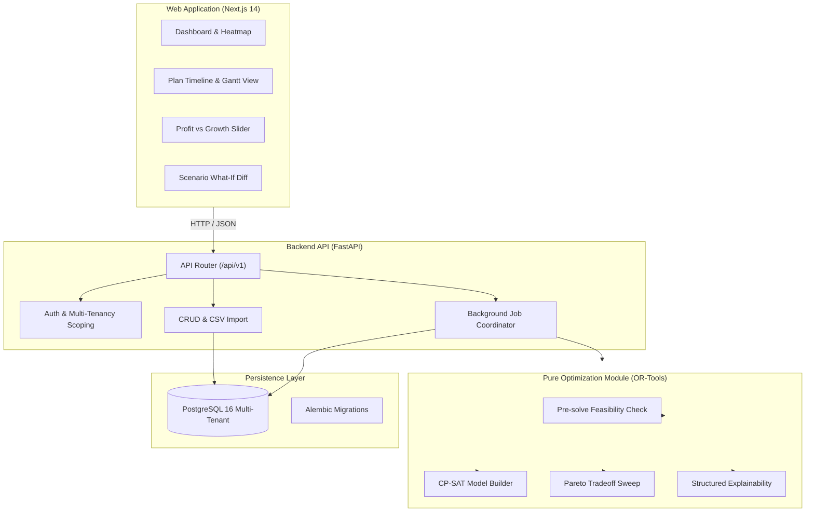

# Allocate — AI-Assisted Resource Allocation Platform

> **Deterministic, explainable, and growth-aware resource allocation for services organizations (50–500 people).**

Allocate helps IT services, consulting, and digital agency leaders answer three fundamental operational questions:
1. **Which projects to take on** given available team capacity (project portfolio selection).
2. **Who should work on what**, and for how many hours per week (optimal assignment).
3. **How to structure each team** with balanced leads, mentors, and stretch growth opportunities.

---

## 🏛️ Architecture Overview

Allocate is structured as a modular monolith in a monorepo:
- `apps/api`: Python 3.12 FastAPI backend + SQLAlchemy 2.0 + Google OR-Tools CP-SAT engine.
- `apps/web`: Next.js 14 (App Router) + TypeScript + Tailwind + TanStack Query + Recharts.
- `docs`: Architecture specification, database schema, and mathematical formulation.



---

## 🧠 The Optimization Model in Plain English

Rather than relying on ungrounded generative LLM guesses, Allocate uses a deterministic mathematical constraint solver (**Google OR-Tools CP-SAT**).

### 1. Hard Constraints (Must NEVER be violated)
- **Zero hours on leave:** Employees on PTO or sick leave are strictly allocated 0 hours.
- **Weekly capacity & overtime limits:** Total weekly hours cannot exceed 40 standard hours plus employee-specific max overtime (e.g. 10 hours).
- **All-or-nothing project staffing:** If a project is selected, every role must be 100% staffed across all weeks. Unselected projects receive 0 hours.
- **Mandatory projects:** Selected without exception. If impossible, the pre-solve feasibility diagnostic explains exactly why.
- **No fragmented scraps:** Assignments must meet a minimum block size (e.g. 10 hours/week) and cap concurrent projects at 2 per employee.
- **Mentorship for stretch roles:** An employee one level below required proficiency may take a stretch role **only** if a qualified mentor is staffed on the same project. The mentor’s capacity is reduced by 10% of the mentee’s hours.

### 2. Tunable Multi-Objective Optimization
Managers use a single **Profit vs. Growth** slider in the UI ($0 \le \lambda \le 1$):
- **Profit Objective:** Maximizes project revenue minus labor costs and overtime penalties.
- **Growth Objective:** Rewards closing skill gaps matching employee career aspirations, stretch opportunities, and mentorship.
- **Workload Balance:** Penalizes uneven utilization across the team and avoids burnout (utilization $>90\%$).

All plans are strictly advisory: a human manager reviews, overrides if necessary, and approves.

---

## 🚀 Quick Start Guide

### Option 1: Docker Compose (Recommended for Production / Containers)
```bash
# 1. Clone repository and copy environment configuration
cp .env.example .env

# 2. Build and start services (Postgres, API, Web)
docker compose up -d

# 3. Apply database migrations
docker compose exec api alembic upgrade head

# 4. Populate realistic demo dataset (40 employees, 12 projects)
docker compose exec api python -m app.scripts.seed

# 5. Access the applications
# Frontend:  http://localhost:3000
# Backend:   http://localhost:8000/docs
```

### Option 2: Local Development (Host Python & SQLite/Postgres)
```bash
# 1. Set up backend virtual environment
cd apps/api
python -m venv .venv
# Windows: .venv\Scripts\activate | Unix: source .venv/bin/activate
pip install -r requirements.txt

# 2. Run database migrations
alembic upgrade head

# 3. Seed realistic demo dataset
python -m app.scripts.seed

# 4. Run test suite
pytest -v

# 5. Start API server
uvicorn app.main:app --reload --port 8000
```

---

## 🧪 Testing

```bash
# Run backend tests (models, tenancy, seed integrity)
cd apps/api
pytest -v
```

---

## 📚 Documentation Links
- [Database Schema Specification](file:///c:/Users/HP/Desktop/ABC_Pro/docs/schema.md)
- [System Architecture](file:///c:/Users/HP/Desktop/ABC_Pro/docs/architecture.md)
- [Full Mathematical Formulation](file:///c:/Users/HP/Desktop/ABC_Pro/docs/model.md)
- [Product Requirements Document](file:///c:/Users/HP/Desktop/ABC_Pro/PRD%20Allocate%20%E2%80%93%20AI-Assisted%20Resource%20Allocation%20Platform.md)
