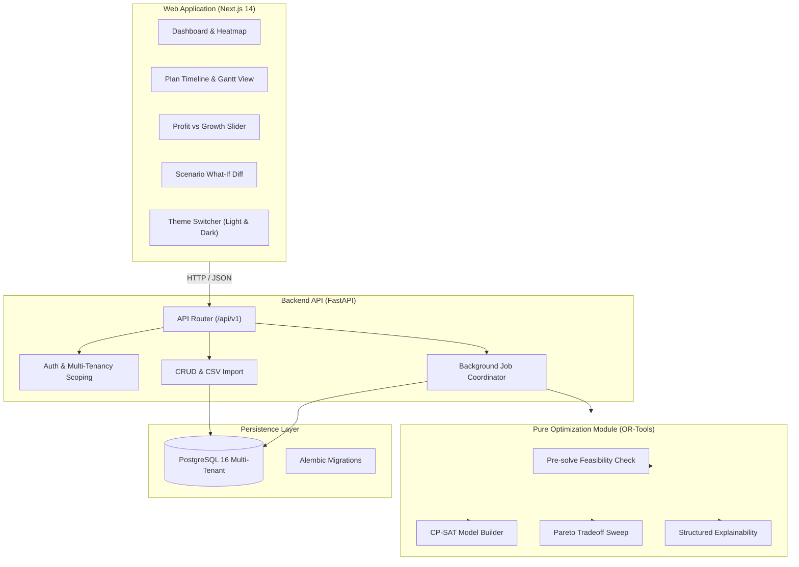

# Allocate — AI-Assisted Resource Allocation Platform

> **Deterministic, explainable, and growth-aware resource allocation for services organizations (50–500 people).**

Allocate helps IT services, consulting, and digital agency leaders answer three fundamental operational questions:
1. **Which projects to take on** given available team capacity (project portfolio selection).
2. **Who should work on what**, and for how many hours per week (optimal assignment).
3. **How to structure each team** with balanced leads, mentors, and stretch growth opportunities.

---

## 🏛️ Architecture Overview

Allocate is structured as a modular monolith in a monorepo:
- `apps/api`: Python 3.12 FastAPI backend + SQLAlchemy 2.0 + Google OR-Tools CP-SAT engine.
- `apps/web`: Next.js 14 (App Router) + TypeScript + Tailwind CSS (Light & Dark Theme) + TanStack Query + Recharts.
- `docs`: Architecture specification, database schema, and mathematical formulation.



---

## 🌟 Key Product Features

### 1. Dashboard & Utilization Heatmap (`/`)
- **Key Metrics (FR-22):** Real-time cards for Net Portfolio Profit, Team Growth Score, Billable Utilization Rate, and Project Acceptance Rate.
- **12-Week Team Utilization Heatmap:** Weekly hours vs. 40h standard capacity with color-coded bench (gray), optimal 40h (green), and overtime (amber) indicators. Click any cell to view detailed project allocations and mentoring ties.
- **Explainability Panel (FR-20):** Displays accepted projects alongside dropped projects accompanied by **plain-language counterfactual solver explanations**.

### 2. Staffing Plans & Tradeoff Tuning (`/plans`)
- **Profit vs. Growth Slider (FR-3, FR-25):** Single 0 to 1 control balancing short-term margin against employee development and stretch opportunities.
- **Pareto Tradeoff Frontier (FR-10, FR-25):** Interactive **Recharts** chart plotting optimal points across weight settings.
- **Interactive Timeline / Gantt Grid (FR-24):** 12-week grid switchable by Engineer or by Project with indicators for stretch assignments (`✨`), mentors (`🤝`), and locked assignments (`🔒`).
- **Structured Explainability Modal (FR-19):** Deep-dive dialog explaining competency matches, mentor hours deduction (HC-6), growth score contributions, and fixed-lock toggling.

### 3. What-If Scenarios & Diff Analysis (`/scenarios`)
- **Side-by-Side Diff (FR-15, FR-26):** Evaluates counterfactuals (employee absences, added deals, weight shifts) against the baseline plan, calculating profit deltas, growth deltas, and staffing perturbations.

### 4. Data Management & Skills Matrix (`/employees`, `/projects`, `/skills`)
- **Employee Roster (FR-1):** Hourly rates, standard/overtime capacities, career goals, and skills.
- **Projects & Role Demands (FR-3, FR-4):** Client contracts, revenue, mandatory constraints (HC-3), and skill requirement levels.
- **Interactive Skills Matrix (FR-2, FR-23):** Employees $\times$ Skills grid with category filters and inline editors for proficiency (1–5) and aspirational growth targets (1–5).
- **CSV Ingestion (FR-6):** Bulk upload modal with row-level validation.

### 5. Dual-Theme Design (Light & Dark)
- Full light theme with clean off-white backgrounds, crisp typography, and soft shadows.
- One-click **Sun/Moon theme toggle** in the navigation bar with `localStorage` persistence.

---

## 🚀 Quick Start Guide

### Option 1: Docker Compose (Full Stack)
```bash
# 1. Clone repository and copy environment configuration
cp .env.example .env

# 2. Build and start services (Postgres, API, Web)
docker compose up -d

# 3. Apply database migrations
docker compose exec api alembic upgrade head

# 4. Populate realistic demo dataset (40 employees, 12 projects)
docker compose exec api python -m app.scripts.seed

# 5. Access the applications
# Frontend:  http://localhost:3000
# Backend:   http://localhost:8000/docs
```

### Option 2: Running Locally

#### Backend (FastAPI + OR-Tools)
```bash
cd apps/api

# 1. Set up virtual environment
python -m venv .venv
# Windows:
.venv\Scripts\activate
# Unix/macOS:
source .venv/bin/activate

# 2. Install dependencies
pip install -r requirements.txt

# 3. Run database migrations and seed data
alembic upgrade head
python -m app.scripts.seed

# 4. Run tests (28 tests passing)
pytest -v

# 5. Start API server
uvicorn app.main:app --reload --port 8000
```

#### Frontend (Next.js 14)
```bash
cd apps/web

# 1. Install dependencies
npm install --legacy-peer-deps

# 2. Verify production build
npm run build

# 3. Start development server
npm run dev
# Access at http://localhost:3000 (or http://localhost:3001)
```

---

## 🧪 Testing

```bash
# Backend unit & integration test suite (28 tests)
cd apps/api
pytest -v

# Frontend type-check and static build verification
cd apps/web
npm run build
```

---

## 📚 Documentation Links
- [Database Schema Specification](docs/schema.md)
- [System Architecture](docs/architecture.md)
- [Full Mathematical Formulation](docs/model.md)
- [Product Requirements Document (PRD)](PRD%20Allocate%20%E2%80%93%20AI-Assisted%20Resource%20Allocation%20Platform.md)
