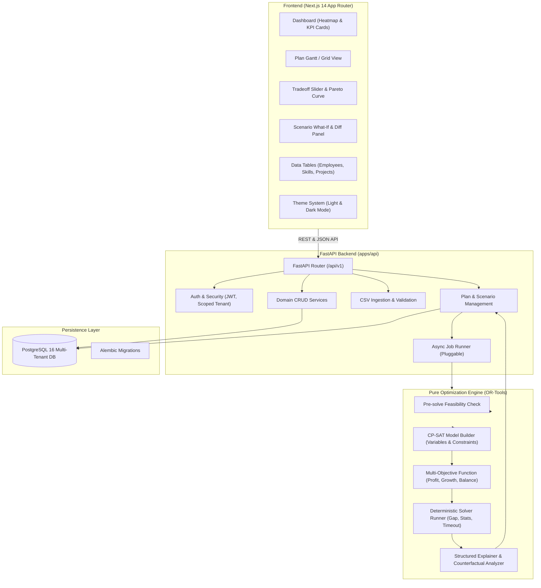

# Allocate Platform Architecture

Allocate is built as a **modular monolith** in a single repository, separating concerns between domain persistence, optimization, API services, and the user interface.

## System Architecture Diagram

---

## Architectural Principles

1. **Deterministic Optimization Core**:
   The optimization module is implemented as a pure Python module with typed dataclasses, without database or web framework dependencies. It can be executed from a CLI, tested independently, and is fully reproducible via fixed random seeds and SHA-256 inputs hashing.

2. **Advisory Decisions, Human in the Loop**:
   The engine provides recommendations with rich, structured explanations. All plans start in `draft` status and require explicit review, manual overrides (if needed), and approval by authorized roles.

3. **Multi-Tenancy by Construction**:
   All database tables include `org_id`, and all service queries are scoped to the active tenant.

4. **Extensible Asynchronous Execution**:
   Optimization jobs are executed asynchronously behind an abstract job runner interface. In the MVP, FastAPI background tasks manage worker threads, with clean extension points for Celery or Temporal.

5. **Explainability without Hallucination**:
   Explanations for why an employee was staffed (skill match, growth target alignment, mentor pairing) and why a project was dropped (capacity bottleneck, skill deficit, lower marginal contribution) are computed directly from mathematical solver data and counterfactual re-solves, avoiding black-box LLM hallucinations.

6. **Dual-Theme Design System**:
   The frontend is built with Next.js 14 (App Router) and Tailwind CSS, featuring full light mode and dark mode support with localStorage persistence, fluid micro-animations, Recharts Pareto frontier visualizer, and responsive desktop-first layout ($1280\text{px}+$ viewport).
