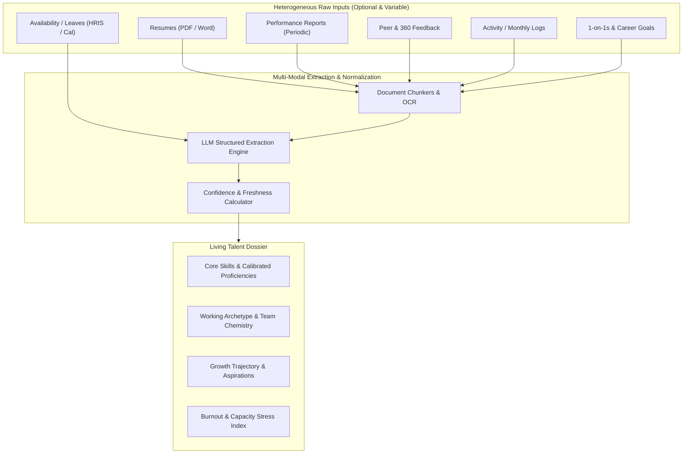
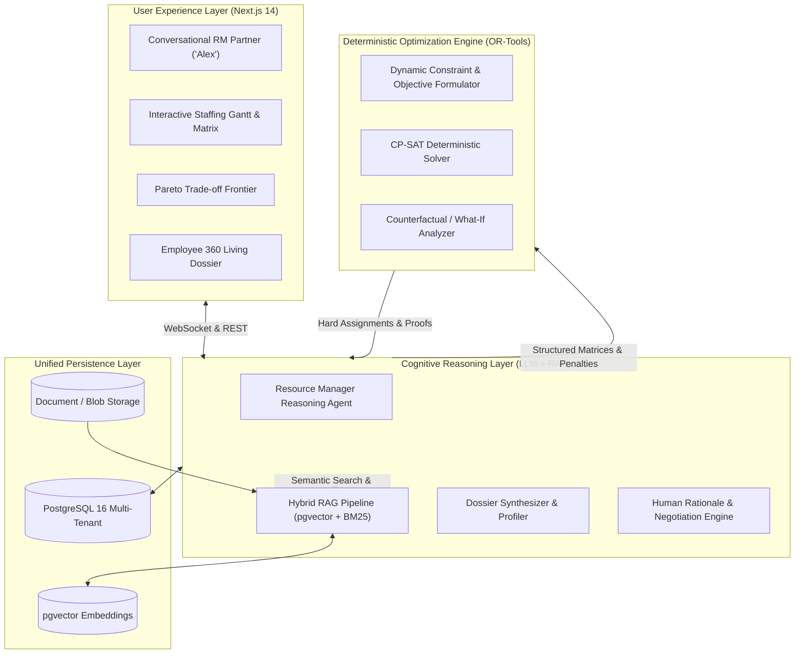
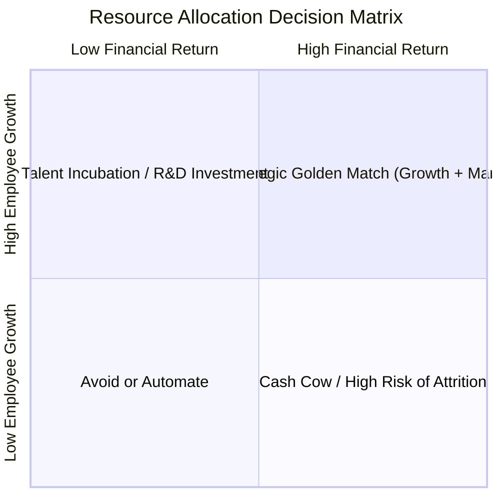
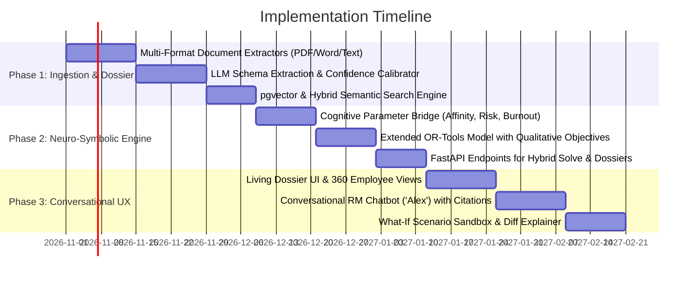

# Project Plan: Cognitive Human-Like Resource Manager ("Allocate AI")

## 1. Executive Summary & Vision

Traditional resource management platforms (and spreadsheet-based workflows) treat people as fungible interchangeable cogs: `Developer + Python + 40 hrs/week = Assigned`. This mechanical approach leads to **burnout, mismatched team dynamics, blocked career growth, missed client expectations, and sub-optimal margins**.

A seasoned **human Resource Manager (RM)** operates very differently:
- They read between the lines of quarterly performance reviews and 360 feedback.
- They remember who works well together, who thrives in ambiguous greenfield architecture vs. disciplined maintenance, and who mentored whom successfully.
- They protect employees from burnout after grueling sprints, while simultaneously nudging high-potential talent into strategic "stretch" assignments.
- They balance empathy with fiduciary responsibility: keeping billable utilization high, controlling delivery risk, and maximizing project profitability.

### The Objective
**Allocate AI** is an intelligent, human-like Resource Management platform designed to emulate the intuition, empathy, and strategic negotiation skills of an expert Resource Manager, augmented with the mathematical precision of deterministic combinatorial optimization.

It ingests whatever company data is available—from rich multi-year performance histories and 360 feedback to barebones resumes and simple availability sheets—and synthesizes a holistic **Living Talent Dossier**. Using a **Neuro-Symbolic Architecture** (combining Large Language Models, Retrieval-Augmented Generation, and OR-Tools CP-SAT), it delivers:
1. **Right Skills & Configuration**: Mathematically guaranteed feasibility and skill-level coverage.
2. **Right Learning & Matchups**: Growth-oriented stretch allocations with deliberate mentor-mentee pairing and complementary working styles.
3. **Right Financial & Capacity Balance**: Maximizing margins, billable utilization, and client retention while mitigating burnout.
4. **Human-Like Advisory Experience**: A conversational partner that explains trade-offs, understands natural language "what-if" scenarios, and advocates for both people and the business.

---

## 2. Ingestion Strategy: Handling Heterogeneous & Sparse Data

A core reality across companies is that data maturity varies wildly:
- **Company A** might only have a Google Drive of PDF resumes and an Excel sheet of planned PTO.
- **Company B** may maintain formal quarterly reviews, Workday job levels, and peer feedback in Lattice.
- **Company C** might have detailed monthly delivery reports, Jira ticket metrics, and client satisfaction surveys, but outdated resumes.

The platform must operate under a **Zero-Assumption, Progressive Enrichment Model**.

### 2.1 The Data Spectrum

| Data Source | Format / Modality | Extracted Qualitative & Quantitative Signals | Criticality |
|---|---|---|---|
| **Employee Availability** | Calendars, HRIS, Spreadsheets, PTO requests | Available hours per week, planned leaves, part-time fractions, timezone overlaps | **Mandatory** (fallback to 40h/wk if unlisted) |
| **Resumes / CVs** | PDF, DOCX, LinkedIn export, plain text | Core tech stack, domain industries, past roles, seniority trajectory, formal education/certifications | **High** (primary source for cold-start skill extraction) |
| **Performance Reports** | Annual / Semi-Annual reviews (PDF, JSON, HTML) | Execution reliability, leadership aptitude, speed vs. thoroughness, problem-solving under ambiguity | **Medium-High** (informs proficiency ratings & delivery risk) |
| **Multi-Source Feedback** | 360 reviews, peer feedback, manager notes | Collaboration style, communication clarity, emotional intelligence, mentorship attitude, friction triggers | **High** for team chemistry & pairing |
| **Periodic Activity Reports** | Monthly / Bimonthly / Quarterly deliverables | Recent project experience, tools recently touched, cadence stamina, sprint velocity trends | **Medium** (prevents skill atrophy assumptions) |
| **1-on-1 Notes & Aspirations** | Text notes, career check-ins, self-evaluations | Desired technologies to learn, target roles (e.g., Tech Lead, Architect), domain interests, travel willingness | **High** for growth satisfaction and retention |
| **Project Post-Mortems / Client NPS** | Retrospectives, client reviews, CSAT scores | High-pressure client compatibility, delivery strengths, recurring project failure points | **Medium** for risk-weighted staffing |

### 2.2 Progressive Profile Enrichment & Confidence Scoring

Rather than failing when data is absent, every employee attribute is stored as a tuple:
$$\text{Attribute} = \langle \text{Value}, \text{Confidence} \in [0.0, 1.0], \text{EvidenceTrail}, \text{LastUpdated} \rangle$$



- **Level 0 (Minimal Ingestion)**: Only Resume + Availability available.
  - Skills and proficiencies inferred with moderate confidence ($0.6$).
  - Growth goals inferred from resume progression ($0.4$ confidence).
  - Optimizer runs baseline skill-match and margin maximization.
- **Level 1 (Performance & Activity Added)**:
  - Skill confidence rises to $0.9$. Actual delivery speed and autonomy calibrated.
  - Risk parameters updated based on performance history.
- **Level 2 (Feedback & 1-on-1s Added)**:
  - Full human-like simulation enabled: mentorship chemistry, communication pairings, burnout prevention, and bespoke career pathing.

---

## 3. High-Level System Architecture

To avoid the twin pitfalls of **hallucinating LLMs** (which fail at strict mathematical capacity constraints) and **rigid optimization models** (which are blind to human emotion, culture, and career dreams), Allocate AI uses a **Neuro-Symbolic Triad**:



### The Three Pillars:
1. **The Cognitive Interpreter (LLM + RAG)**:
   - Ingests semi-structured and unstructured text.
   - Extracts insights, sentiments, team dynamics, and aspirations.
   - Converts fuzzy human factors into quantified parameters (e.g., Synergy Affinity Matrix $A_{e_1, e_2} \in [-1.0, 1.0]$, Burnout Vulnerability Factor $\beta_e \in [0.8, 1.2]$, Stretch Readiness Score $\sigma_{e, s} \in [0.0, 1.0]$).
2. **The Mathematical Core (Google OR-Tools CP-SAT)**:
   - Treats capacity, budget, deadlines, and skill prerequisites as non-negotiable hard constraints.
   - Optimizes multi-objective utility functions: Profit Margin + Team Synergy + Career Growth + Workload Balance.
   - Operates in polynomial / bounded branch-and-cut time, delivering globally optimal or bounded solutions.
3. **The Conversational Explainer & Advisor**:
   - Takes solver output and counterfactual margins.
   - Speaks to leadership and project managers in natural, conversational, consultative prose.
   - Justifies decisions with clear citations back to performance reviews, feedback, and financial metrics.

---

## 4. The Human-Like Decision Framework

A true Resource Manager balances five interrelated dimensions for every single seat:



### 4.1 Dimension 1: True Competency & Subconscious Strengths
- **Beyond Keywords**: A resume may say "Python 5 years", but performance reports indicate whether they write high-throughput async microservices or simple data scripts.
- **Cadence & Working Style**: Monthly reports reveal whether an engineer excels at prototyping (0 to 1) or hardening enterprise systems (1 to 100). The engine tags employees with working archetypes (e.g., *Pathfinder, Optimizer, Firefighter, Architect*).

### 4.2 Dimension 2: Team Chemistry & Configuration (Matchups)
- **Mentorship Pairing**: When assigning an employee in a stretch role ($ReqProf - 1$), the model mandates staffing an approved mentor on the same project who possesses verified mastery ($ReqProf \ge 4$) and positive feedback regarding coaching.
- **Complementary Personalities**: If peer feedback reveals that Employee A struggles with client-facing diplomacy, the system pairs them with a Delivery Lead or Senior Engineer celebrated for stakeholder management.
- **Friction Avoidance**: Ingested feedback flags persistent collaboration bottlenecks, applying a soft negative affinity penalty between individuals who have documented interpersonal friction.

### 4.3 Dimension 3: Career Growth & Aspirations (Retention Protection)
- Staffing senior engineers repeatedly on repetitive maintenance projects triggers high turnover.
- Allocate AI explicitly reserves a portion of capacity for "Stretch Assignments", matching employees against skills they have expressed an active desire to learn in 1-on-1s.

### 4.4 Dimension 4: Burnout & Sustainable Cadence
- Analyzes historical workload and overtime patterns from monthly reports.
- If an employee has spent 3 consecutive months on high-urgency rescue projects, the system increases their **Burnout Vulnerability Factor**, discouraging the optimizer from putting them on high-stress, overtime-heavy critical path roles.

### 4.5 Dimension 5: Financial Realities & Company Earnings
- Evaluates project billing models: Fixed Price vs. Time & Materials (T&M).
- **T&M**: Maximizes billable hours at target rate card margins.
- **Fixed Price**: Optimizes team velocity to deliver within fewer hours, preserving margin.
- Balances high-cost senior talent with lower-cost junior talent under structured mentorship to maximize blended gross margin.

---

## 5. Detailed Component Specifications

### 5.1 Ingestion & Document Intelligence (The Data Ingestor)
- **Input Pipeline**: Accepts PDF, DOCX, TXT, CSV, JSON, and Google/Microsoft API connectors.
- **Chunking & Indexing**:
  - Contextual chunking: Performance reviews are chunked by evaluation cycle, preserving reviewer context.
  - Hybrid Indexing: Dense embeddings (`text-embedding-3-small` / open-source `bge-large-en-v1.5`) alongside BM25 sparse lexical tokens in PostgreSQL with `pgvector`.
- **Extraction Schema**:
  ```json
  {
    "employee_id": "EMP-042",
    "name": "Sarah Chen",
    "extracted_skills": [
      {
        "skill": "FastAPI",
        "proficiency": 4,
        "confidence": 0.92,
        "evidence": "Led backend rewrite in Q2 2025 review; praised for 40% latency reduction"
      }
    ],
    "growth_interests": [
      {
        "skill": "Distributed Systems / Rust",
        "origin": "1-on-1 Career Goals June 2025",
        "urgency": "High"
      }
    ],
    "archetype": "Architect / Greenfield Builder",
    "collaboration_notes": {
      "coaching_sentiment": "Strong mentor; guided 2 junior engineers through onboarding in Q1",
      "preferred_team_size": "3-6",
      "client_facing_comfort": "High"
    },
    "burnout_risk_score": 0.25
  }
  ```

### 5.2 The Living Talent Dossier (Memory Layer)
- Maintained as an evolving graph in PostgreSQL:
  - `employees` (core demographic, capacity, internal cost, billable target).
  - `employee_dossier_snapshots` (temporal timeline of reviews, projects completed, feedback sentiment).
  - `employee_skills` (current level, target level, confidence, verification source).
  - `employee_affinity_edges` (synergy and friction scores between staff members).

### 5.3 Cognitive Optimization Bridge (Neuro-Symbolic Translation)
The Cognitive Layer converts qualitative findings into mathematical weights for the CP-SAT engine:
- **Affinity Bonus**: Adds objective reward $\sum_{e_1, e_2, p, w} A_{e_1, e_2} \cdot z_{e_1, e_2, p, w}$ when synergistic employees share a project.
- **Growth Value**: Adds objective reward $\sum_{e, r, w} G_{e, r} \cdot x_{e, r, w}$ for fulfilling stated career aspirations.
- **Burnout Mitigation**: Imposes escalating overtime penalties $\rho_{\text{ot}} \cdot (1 + \beta_e)$ for staff with high historical fatigue.

### 5.4 Conversational Resource Manager ("Alex")
- **Tone**: Empathetic, commercially astute, proactive, structured.
- **Capabilities**:
  - **Natural Staffing Queries**: *"Who should lead the new Fintech banking project starting next month?"*
  - **Explainability**: *"Why did you recommend pairing Alex with Priya instead of David?"*
    - *Response*: *"While David has higher raw seniority in AWS, Priya's Q3 review highlights strong microservices experience and an explicit goal to step into lead design. Alex received top feedback for mentoring rising stars, and their internal billing rate leaves the project at a 48% gross margin, compared to 36% with David."*
  - **What-If Negotiation**: *"What if the client pulls the start date forward by 3 weeks?"*
  - **Proactive Warnings**: *"Notice: Marcus has been on 45+ hours for 6 consecutive weeks. I recommend rotating him off Project Apollo to prevent attrition risk."*

---

## 6. Mathematical Optimization Formulation (Extended)

Building upon the existing Allocate model, we integrate the qualitative factors synthesized by the LLM:

### 6.1 Objective Function
$$\max \quad W_{\text{profit}} \cdot \text{NetMargin} + W_{\text{growth}} \cdot \text{GrowthScore} + W_{\text{synergy}} \cdot \text{SynergyScore} - W_{\text{risk}} \cdot \text{DeliveryRisk} - W_{\text{churn}} \cdot \text{BurnoutPenalty}$$

Where:
- $\text{NetMargin} = \sum_{p \in P} y_p \cdot Rev_p - \sum_{e, r, w} (c_e \cdot x_{e, r, w} + \rho_{\text{ot}} \cdot ot_{e, w})$
- $\text{GrowthScore} = \sum_{e, r, w} \left( \sum_{s \in S_r} \text{Aspiration}_{e, s} \cdot \mathbb{I}_{Prof_{e, s} < ReqProf_{r, s}} \right) x_{e, r, w}$
- $\text{SynergyScore} = \sum_{(e_1, e_2) \in \text{Pairs}} A_{e_1, e_2} \cdot \text{CoStaffed}_{e_1, e_2}$
- $\text{DeliveryRisk} = \sum_{e, r, w} \text{RiskFactor}_{e, r} \cdot x_{e, r, w}$
- $\text{BurnoutPenalty} = \sum_{e, w} \beta_e \cdot ot_{e, w}$

### 6.2 Hard Constraints
1. **Capacity & Leave**: Hours allocated $\le$ Base Capacity (adjusted for leaves) $+$ Overtime.
2. **Role Coverage**: Selected projects must satisfy 100% of required weekly hours per role.
3. **Skill Prerequisites**: For standard staffing, $Prof_{e, s} \ge ReqProf_{r, s}$.
4. **Mentorship Rule**: For stretch staffing ($Prof_{e, s} = ReqProf_{r, s} - 1$), a designated mentor with $Prof_{m, s} \ge ReqProf_{r, s}$ and positive mentorship evaluation must be concurrently staffed on project $p$.
5. **Context Switching Limit**: Max concurrent active projects per employee per week $\le K_{\text{max\_proj}}$ (default 2).

---

## 7. Implementation Roadmap & Phased Delivery



### Phase 1: Data Ingestion & The Living Dossier (Weeks 1–5)
- Build ingestion pipelines for Resumes, Performance Reviews, Feedback forms, and Worklogs.
- Deploy LLM structured parsing with confidence annotations and source evidence tracking.
- Implement PostgreSQL schema extensions + `pgvector` store for semantic employee search.
- Graceful degradation tests: verify that the system runs smoothly with any subset of data.

### Phase 2: The Neuro-Symbolic Optimization Core (Weeks 6–9)
- Formulate the Cognitive Bridge translating text sentiment and feedback into affinity/burnout/growth parameters.
- Enhance the OR-Tools CP-SAT model with mentor-mentee pairing, synergy maximization, and fatigue penalization.
- Implement pre-solve feasibility checks and counterfactual re-solvers to determine why candidate $A$ was chosen over $B$.

### Phase 3: Conversational Interface & Front-End Experience (Weeks 10–13)
- Deliver the **Conversational Resource Manager ("Alex")** interface in Next.js 14.
- Build the **Living Dossier 360 View**: interactive breakdown of each employee's skills, extracted evidence citations, growth trajectory, and recent feedback.
- Interactive **Pareto Frontier**: allow executives to slide between *Maximum Profit* and *Maximum Employee Growth/Retention*, viewing real-time allocation updates.
- Natural language "What-If" simulation playground.

---

## 8. Success Metrics & Validation Strategy

| Metric | Target | Measurement Method |
|---|---|---|
| **Feasibility & Constraint Adherence** | 100% | Zero capacity over-allocations, zero unmentored stretch placements |
| **Gross Margin Optimization** | $+12\text{--}22\%$ vs. naive staffing | Benchmarked against historical manual allocations on standard client portfolios |
| **Employee Growth Velocity** | $\ge 35\%$ of staff on stretch/learning roles | Tracked via skills upgraded through real-world project delivery |
| **Burnout Reduction** | $> 50\%$ drop in consecutive overtime streaks | Fatigue index monitoring across planning horizons |
| **Explainability Trust** | $> 90\%$ manager acceptance of AI recommendations | User rating on clarity and fairness of decision rationales |
| **Graceful Degradation** | Zero errors with sparse data | Automated unit tests covering all permutations of missing inputs |

---

## 9. Conclusion

Allocate AI bridges the gap between cold spreadsheet math and intuitive human leadership. By combining **LLM-powered document intelligence and empathetic reasoning** with **deterministic combinatorial optimization**, it provides organizations with a supercharged Resource Manager that treats employees as unique individuals with aspirations, while steering the company toward maximum operational profitability.
