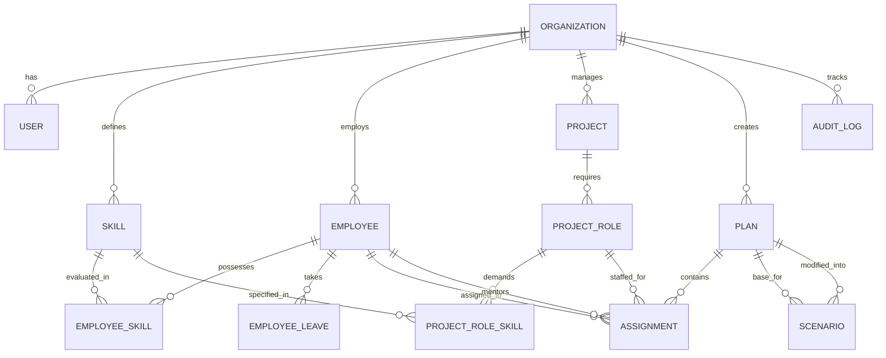

# Database Schema Specification: Allocate

Allocate utilizes **PostgreSQL 16** (with SQLite support for unit testing) and **SQLAlchemy 2.0** with **Alembic** for schema migrations.

## Multi-Tenancy Architecture
Allocate is multi-tenant by design.
- Every tenant belongs to an `Organization`.
- Every domain entity table includes an `org_id` column with a foreign key to `organizations.id` and an index on `(org_id)`.
- All database queries and modifications are strictly scoped by `org_id`.
- Natural unique constraints (e.g., employee email, skill name) are scoped to `(org_id, key)`.

---

## Entity Relationship Overview

---

## Tables & Columns

### 1. `organizations`
Tenant organization boundaries.
| Column | Type | Constraints | Description |
|---|---|---|---|
| `id` | `VARCHAR(36)` | PRIMARY KEY | UUID string identifier |
| `name` | `VARCHAR(255)` | UNIQUE, NOT NULL | Organization name |
| `created_at` | `TIMESTAMP WITH TZ` | NOT NULL | Creation timestamp |
| `updated_at` | `TIMESTAMP WITH TZ` | NOT NULL | Last modification timestamp |

### 2. `users`
Authenticated operators and managers.
| Column | Type | Constraints | Description |
|---|---|---|---|
| `id` | `VARCHAR(36)` | PRIMARY KEY | UUID identifier |
| `org_id` | `VARCHAR(36)` | FK -> `organizations.id` | Tenant isolation key |
| `email` | `VARCHAR(255)` | UNIQUE, NOT NULL | Login email address |
| `hashed_password`| `VARCHAR(255)` | NOT NULL | Bcrypt password hash |
| `full_name` | `VARCHAR(255)` | NOT NULL | Display name |
| `role` | `VARCHAR(50)` | NOT NULL | `admin`, `resource_manager`, `delivery_head`, `team_lead` |
| `is_active` | `BOOLEAN` | NOT NULL, DEFAULT true | Account status |

### 3. `skills`
Skill catalog categorized by domain.
| Column | Type | Constraints | Description |
|---|---|---|---|
| `id` | `VARCHAR(36)` | PRIMARY KEY | UUID identifier |
| `org_id` | `VARCHAR(36)` | FK -> `organizations.id` | Tenant isolation key |
| `name` | `VARCHAR(100)` | NOT NULL | Skill name (e.g., Python, React) |
| `category` | `VARCHAR(100)` | NOT NULL | Category (Frontend, Backend, Cloud, etc.) |
| `description` | `TEXT` | NULL | Guidance and proficiency criteria |

### 4. `employees`
Internal staff available for allocation.
| Column | Type | Constraints | Description |
|---|---|---|---|
| `id` | `VARCHAR(36)` | PRIMARY KEY | UUID identifier |
| `org_id` | `VARCHAR(36)` | FK -> `organizations.id` | Tenant isolation key |
| `name` | `VARCHAR(255)` | NOT NULL | Full name |
| `email` | `VARCHAR(255)` | NOT NULL | Work email (unique per org) |
| `role` | `VARCHAR(100)` | NOT NULL | Title / job level |
| `cost_per_hour` | `FLOAT` | NOT NULL | Internal hourly cost rate |
| `weekly_capacity_hours` | `INTEGER` | NOT NULL, DEFAULT 40 | Standard hours per week |
| `max_overtime_hours` | `INTEGER` | NOT NULL, DEFAULT 10 | Max permitted weekly overtime |
| `start_date` | `DATE` | NOT NULL | Employment start date |
| `end_date` | `DATE` | NULL | Termination date (if applicable) |
| `career_goals` | `JSON` | NOT NULL | List of target skills and aspirations |
| `is_active` | `BOOLEAN` | NOT NULL, DEFAULT true | Active employment flag |

### 5. `employee_skills`
Proficiency matrix and employee growth targets.
| Column | Type | Constraints | Description |
|---|---|---|---|
| `id` | `VARCHAR(36)` | PRIMARY KEY | UUID identifier |
| `org_id` | `VARCHAR(36)` | FK -> `organizations.id` | Tenant isolation key |
| `employee_id` | `VARCHAR(36)` | FK -> `employees.id` | Associated employee |
| `skill_id` | `VARCHAR(36)` | FK -> `skills.id` | Associated skill |
| `proficiency` | `INTEGER` | NOT NULL (1 to 5) | Verified skill proficiency |
| `growth_target` | `INTEGER` | NULL (1 to 5) | Desired target proficiency |

### 6. `employee_leaves`
Planned PTO and unavailability windows.
| Column | Type | Constraints | Description |
|---|---|---|---|
| `id` | `VARCHAR(36)` | PRIMARY KEY | UUID identifier |
| `org_id` | `VARCHAR(36)` | FK -> `organizations.id` | Tenant isolation key |
| `employee_id` | `VARCHAR(36)` | FK -> `employees.id` | Associated employee |
| `start_date` | `DATE` | NOT NULL | Leave start date |
| `end_date` | `DATE` | NOT NULL | Leave end date |
| `reason` | `VARCHAR(255)` | NULL | Description (e.g., Parental, Medical) |

### 7. `projects`
Candidate and active customer projects.
| Column | Type | Constraints | Description |
|---|---|---|---|
| `id` | `VARCHAR(36)` | PRIMARY KEY | UUID identifier |
| `org_id` | `VARCHAR(36)` | FK -> `organizations.id` | Tenant isolation key |
| `name` | `VARCHAR(255)` | NOT NULL | Project name |
| `client` | `VARCHAR(255)` | NOT NULL | Client name |
| `start_date` | `DATE` | NOT NULL | Project kick-off date |
| `end_date` | `DATE` | NOT NULL | Project completion date |
| `revenue` | `FLOAT` | NOT NULL | Total expected revenue |
| `billing_rate_hourly` | `FLOAT` | NULL | Time & materials rate (optional) |
| `priority` | `INTEGER` | NOT NULL (1 to 5) | Strategic priority |
| `mandatory` | `BOOLEAN` | NOT NULL, DEFAULT false | Portfolio selection mandate |
| `status` | `VARCHAR(50)` | NOT NULL | `proposed`, `active`, `completed` |

### 8. `project_roles`
Staffing requirements per project.
| Column | Type | Constraints | Description |
|---|---|---|---|
| `id` | `VARCHAR(36)` | PRIMARY KEY | UUID identifier |
| `org_id` | `VARCHAR(36)` | FK -> `organizations.id` | Tenant isolation key |
| `project_id` | `VARCHAR(36)` | FK -> `projects.id` | Parent project |
| `role_title` | `VARCHAR(100)` | NOT NULL | Role title |
| `hours_per_week` | `INTEGER` | NOT NULL, DEFAULT 40 | Weekly hours demanded |
| `start_date` | `DATE` | NOT NULL | Role start date |
| `end_date` | `DATE` | NOT NULL | Role end date |
| `is_stretch_allowed`| `BOOLEAN` | NOT NULL, DEFAULT false | Allows stretch assignment |

### 9. `project_role_skills`
Skill requirements for project roles.
| Column | Type | Constraints | Description |
|---|---|---|---|
| `id` | `VARCHAR(36)` | PRIMARY KEY | UUID identifier |
| `org_id` | `VARCHAR(36)` | FK -> `organizations.id` | Tenant isolation key |
| `project_role_id`| `VARCHAR(36)` | FK -> `project_roles.id` | Associated role |
| `skill_id` | `VARCHAR(36)` | FK -> `skills.id` | Required skill |
| `min_proficiency`| `INTEGER` | NOT NULL (1 to 5) | Minimum required level |

### 10. `plans`
Versioned optimization plans.
| Column | Type | Constraints | Description |
|---|---|---|---|
| `id` | `VARCHAR(36)` | PRIMARY KEY | UUID identifier |
| `org_id` | `VARCHAR(36)` | FK -> `organizations.id` | Tenant isolation key |
| `name` | `VARCHAR(255)` | NOT NULL | Plan name |
| `status` | `VARCHAR(50)` | NOT NULL | `draft`, `approved`, `rejected` |
| `horizon_weeks` | `INTEGER` | NOT NULL, DEFAULT 12 | Planning horizon |
| `start_date` | `DATE` | NOT NULL | Start date of horizon |
| `profit_weight` | `FLOAT` | NOT NULL | Weight for profit objective |
| `growth_weight` | `FLOAT` | NOT NULL | Weight for growth objective |
| `balance_weight`| `FLOAT` | NOT NULL | Weight for fairness/balance |
| `total_score` | `FLOAT` | NULL | Composite objective value |
| `profit_score` | `FLOAT` | NULL | Realized net profit |
| `growth_score` | `FLOAT` | NULL | Realized growth score |
| `balance_penalty`| `FLOAT` | NULL | Workload imbalance penalty |
| `solver_status` | `VARCHAR(50)` | NULL | `OPTIMAL`, `FEASIBLE`, `INFEASIBLE` |
| `solver_gap` | `FLOAT` | NULL | Relative optimality gap |
| `solver_wall_time_ms`| `FLOAT` | NULL | Solve runtime in milliseconds |
| `inputs_hash` | `VARCHAR(64)` | NULL | SHA-256 fingerprint of inputs |
| `objective_breakdown`| `JSON` | NULL | Itemized objective components |
| `dropped_project_reasons`| `JSON` | NULL | Explanations for dropped projects |
| `created_by` | `VARCHAR(36)` | FK -> `users.id` | Generating user |
| `approved_by` | `VARCHAR(36)` | FK -> `users.id` | Approving user |
| `approved_at` | `TIMESTAMP WITH TZ` | NULL | Approval timestamp |

### 11. `assignments`
Weekly staffing allocations generated by solver or edited by manager.
| Column | Type | Constraints | Description |
|---|---|---|---|
| `id` | `VARCHAR(36)` | PRIMARY KEY | UUID identifier |
| `org_id` | `VARCHAR(36)` | FK -> `organizations.id` | Tenant isolation key |
| `plan_id` | `VARCHAR(36)` | FK -> `plans.id` | Parent plan |
| `employee_id` | `VARCHAR(36)` | FK -> `employees.id` | Staffed employee |
| `project_role_id`| `VARCHAR(36)` | FK -> `project_roles.id` | Staffed role |
| `week_number` | `INTEGER` | NOT NULL (1 to 12) | Planning horizon week index |
| `hours` | `INTEGER` | NOT NULL | Assigned hours in week |
| `is_stretch` | `BOOLEAN` | NOT NULL, DEFAULT false | Stretch assignment flag |
| `mentor_id` | `VARCHAR(36)` | FK -> `employees.id` | Mentor on project if stretch |
| `is_locked` | `BOOLEAN` | NOT NULL, DEFAULT false | Locked against solver override |
| `reasons` | `JSON` | NULL | Explainability structured data |

### 12. `scenarios`
What-if scenario comparisons against a base plan.
| Column | Type | Constraints | Description |
|---|---|---|---|
| `id` | `VARCHAR(36)` | PRIMARY KEY | UUID identifier |
| `org_id` | `VARCHAR(36)` | FK -> `organizations.id` | Tenant isolation key |
| `base_plan_id` | `VARCHAR(36)` | FK -> `plans.id` | Original reference plan |
| `modified_plan_id`| `VARCHAR(36)`| FK -> `plans.id` | Re-solved scenario plan |
| `name` | `VARCHAR(255)` | NOT NULL | Scenario title |
| `description` | `VARCHAR(500)` | NULL | Scenario notes |
| `modifications` | `JSON` | NOT NULL | Modified inputs |
| `diff_summary` | `JSON` | NULL | Profit delta, growth delta, moves |

### 13. `audit_logs`
Immutable audit trail for all governance and operational events.
| Column | Type | Constraints | Description |
|---|---|---|---|
| `id` | `VARCHAR(36)` | PRIMARY KEY | UUID identifier |
| `org_id` | `VARCHAR(36)` | FK -> `organizations.id` | Tenant isolation key |
| `user_id` | `VARCHAR(36)` | FK -> `users.id` | Actor who performed action |
| `action` | `VARCHAR(100)` | NOT NULL | `create`, `update`, `approve_plan`, etc. |
| `entity_type` | `VARCHAR(100)` | NOT NULL | Entity class modified |
| `entity_id` | `VARCHAR(36)` | NOT NULL | Primary key of modified entity |
| `before_state` | `JSON` | NULL | State prior to modification |
| `after_state` | `JSON` | NULL | State after modification |
| `ip_address` | `VARCHAR(50)` | NULL | Client IP address |
